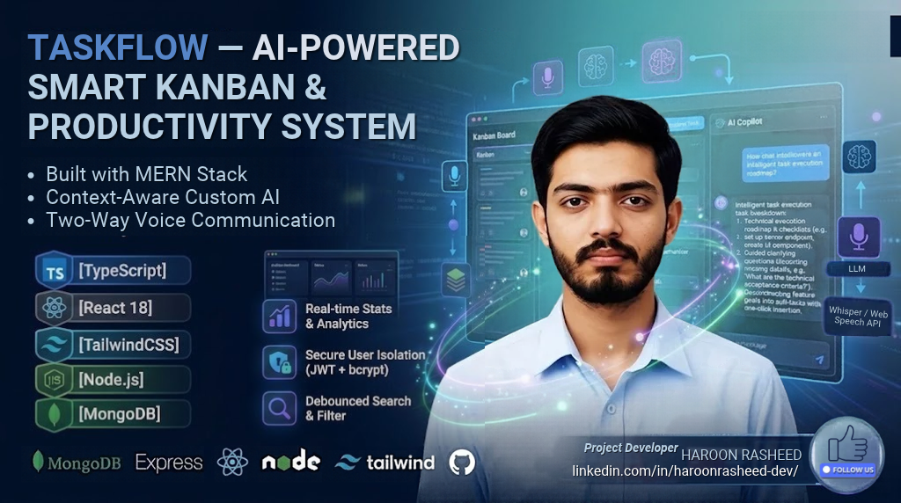

<div align="center">
  

  # TaskFlow — AI-Powered Smart Kanban & Productivity System
  
  **An intelligent full-stack task management platform built with the MERN stack and TypeScript, supercharged with a Context-Aware Custom AI Copilot and Two-Way Voice Communication.**

  [](https://www.typescriptlang.org/)
  [](https://react.dev/)
  [](https://tailwindcss.com/)
  [](https://nodejs.org/)
  [](https://www.mongodb.com/)
</div>

---

## 📌 Overview

TaskFlow is an intelligent, modern full-stack task management platform built with the MERN stack (MongoDB, Express.js, React, Node.js) and Tailwind CSS. Beyond traditional Kanban workflows, it features a context-aware Custom AI Copilot powered by free-tier LLMs (Groq / Google Gemini) that grounds its responses strictly in the user's active tasks, deadlines, and priorities rather than generic replies. The system offers interactive task guidance—analyzing task descriptions to generate step-by-step execution roadmaps and proactively prompting for details when descriptions are missing. It also introduces zero-cost two-way voice communication via Web Speech API and Groq Whisper, allowing users to speak commands, create tasks naturally, and listen to spoken advice. Complete with secure JWT authentication, real-time status management, and an eye-catching dark-mode interface, TaskFlow redefines personal daily productivity.

---

## ✨ Features

- **🤖 Context-Aware Custom AI Copilot (Groq / Gemini Free Tier)**: Strictly grounded in your active board tasks, due dates, and workload metrics. Eliminates generic chatbot fluff.
- **🗣️ Two-Way Voice Communication (100% Free)**:
  - **Speech-to-Text**: Built-in Web Speech API and Groq Whisper for instantaneous voice commands.
  - **Text-to-Speech**: Browser-native Speech Synthesis for spoken advice and status confirmation.
- **🪄 Interactive Task Advisory & Clarification Loop**:
  - Analyzes existing task descriptions to provide technical execution roadmaps and checklists.
  - Detects missing/vague descriptions and asks guided clarifying questions to help flesh out the plan.
- **⚡ Natural Language Task Breakdown**: Turn broad feature goals into actionable sub-tasks with one-click insertion onto the board.
- **📋 Kanban Board with Status Tracking**: Organized columns (`To do`, `In progress`, `Done`) with inline status toggles, priority tagging, and overdue date alerts.
- **📊 Real-time Stats & Analytics**: Instant counts for total, pending, ongoing, and completed tasks powered by MongoDB aggregation.
- **🔐 Secure User Isolation**: Full JWT-based authentication with bcrypt password hashing and user-specific task isolation.
- **🔍 Debounced Search & Filter**: Real-time title search and priority filtering.
- **🎨 Eye-Catching Dark Glassmorphism UI**: Handcrafted responsive UI using Tailwind CSS, radial gradient backdrops, and modern micro-interactions.

---

## 🛠️ Tech Stack

| Layer | Technologies |
|---|---|
| **Frontend** | React 18, TypeScript, Tailwind CSS, Vite, React Router 6 |
| **Backend** | Node.js, Express 4, TypeScript, Zod Validation, tsx |
| **Database** | MongoDB + Mongoose 8 |
| **AI & Voice Engine** | Google Gemini API / Groq API (Free Tier), Web Speech API, Groq Whisper |
| **Security** | JWT (JSON Web Tokens), bcryptjs |

---

## 🚀 Quick Start

### Prerequisites
- Node.js 18+
- MongoDB instance (local or MongoDB Atlas)

### 1. Installation
```bash
npm run install:all          # Installs dependencies for root, server, and client
```

### 2. Environment Setup
Configure your environment files:
- **`server/.env`**:
  ```env
  PORT=5000
  MONGO_URI=mongodb://localhost:27017/taskflow
  JWT_SECRET=your_super_secret_jwt_key
  CLIENT_ORIGIN=http://localhost:5173
  # Free-tier AI keys (use either or both)
  GEMINI_API_KEY=your_gemini_api_key_here
  GROQ_API_KEY=your_groq_api_key_here
  ```

### 3. Run Development Servers
```bash
npm run dev                  # Backend on :5000, Vite Client on http://localhost:5173
```

### 4. Production Build
```bash
npm run build                # Compiles TypeScript and builds Vite client
npm start                    # Express serves API + compiled client on :5000
```

---

## 📡 API Reference

### Authentication
| Method | Endpoint | Description |
|---|---|---|
| `POST` | `/api/auth/register` | Register new user account |
| `POST` | `/api/auth/login` | Authenticate user and return JWT |
| `GET` | `/api/auth/me` | Fetch authenticated user profile |

### Tasks
| Method | Endpoint | Description |
|---|---|---|
| `GET` | `/api/tasks?status=&priority=&q=` | Query & filter authenticated user's tasks |
| `GET` | `/api/tasks/stats` | Aggregated task counts per status |
| `POST` | `/api/tasks` | Create new task |
| `PUT` | `/api/tasks/:id` | Update task details or status |
| `DELETE` | `/api/tasks/:id` | Delete task |

### AI Copilot & Voice
| Method | Endpoint | Description |
|---|---|---|
| `POST` | `/api/ai/chat` | Send prompt with active task context (Gemini/Groq) |
| `POST` | `/api/ai/breakdown` | Deconstruct a high-level task into actionable sub-tasks |
| `POST` | `/api/ai/guide` | Generate guidance or ask clarifying questions based on task description |

---

## 📂 Project Structure

```
mern-taskflow/
├── client/                     # React + Vite + Tailwind Frontend
│   ├── public/
│   ├── src/
│   │   ├── components/         # TaskCard, TaskForm, LogoMark, AICopilotModal, etc.
│   │   ├── context/            # AuthContext, AIStateContext
│   │   ├── pages/              # Dashboard, AuthPage
│   │   ├── api.ts              # Typed Axios/Fetch client
│   │   ├── types.ts            # Shared frontend TypeScript interfaces
│   │   └── ui.ts               # Shared Tailwind design tokens
│   └── tailwind.config.js
├── server/                     # Express + Mongoose Backend
│   └── src/
│       ├── config/             # Database connection & AI client config
│       ├── middleware/         # Auth guard, error handler, validation
│       ├── models/             # User, Task Mongoose models
│       ├── routes/             # Auth, Tasks, and AI routes
│       ├── utils/              # Prompt builders, context injectors
│       └── index.ts            # Express server entry point
├── intro.png                   # 16:9 Project banner image
└── package.json
```

---

## 📄 License
This project is open-source and available under the [MIT License](LICENSE).
